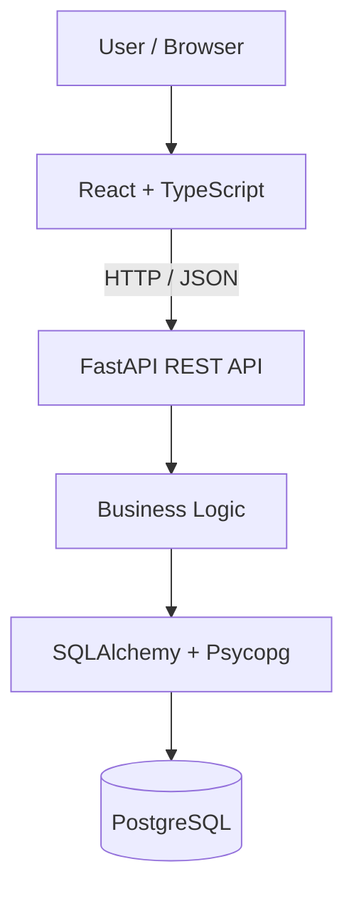

# FieldOps Pro — System Architecture

## 1. Architecture Overview

FieldOps Pro uses a three-tier architecture:

1. Frontend: React + TypeScript
2. Backend: Python + FastAPI
3. Database: PostgreSQL

The backend follows a modular monolith design.

## 2. Architecture Diagram



## 3. Frontend

Technology: React + TypeScript + Vite

Responsibilities:
- Display user interfaces
- Collect user inputs
- Call backend APIs
- Display server responses
- Manage frontend state

## 4. Backend

Technology: Python + FastAPI

Responsibilities:
- Handle API requests
- Validate data
- Authenticate users
- Enforce permissions
- Execute business logic
- Access PostgreSQL

## 5. Database

Technology: PostgreSQL 17

Responsibilities:
- Store organization information
- Store users and events
- Manage equipment and reservations
- Store tasks and financial records
- Maintain data integrity

## 6. Current Implementation

Completed:
- React frontend
- FastAPI backend
- PostgreSQL Docker container
- Frontend-to-backend communication
- Backend-to-database connection
- Health check endpoints

## 7. Planned Components

- Authentication and authorization
- Event and inventory services
- Budget and financial services
- Offline storage using IndexedDB
- Offline synchronization API
- CSV/Excel processing using Pandas
- Automated testing
- CI/CD using GitHub Actions
- Cloud deployment

## 8. Architecture Principles

- Separation of concerns
- Modular backend design
- RESTful communication
- Secure database access
- Reliable database transactions
- Maintainable and testable code
```
