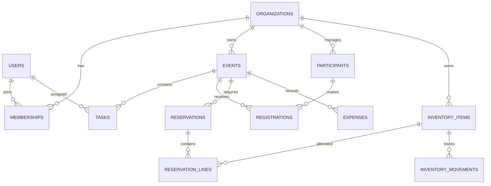

# FieldOps Pro — Database Design

## 1. Overview

Database: PostgreSQL 17

FieldOps Pro uses a relational database to manage
organizations, events, tasks, participants, equipment,
reservations, and expenses.

This document describes the initial logical schema.
The design will be expanded as features are implemented.

## 2. Main Tables

### USERS
- id (UUID, primary key)
- name
- email (unique)
- password_hash
- created_at

### ORGANIZATIONS
- id (UUID, primary key)
- name
- created_at

### MEMBERSHIPS
- id (UUID, primary key)
- user_id (foreign key)
- organization_id (foreign key)
- role
- status

### EVENTS
- id (UUID, primary key)
- organization_id (foreign key)
- name
- description
- start_at
- end_at
- status

### TASKS
- id (UUID, primary key)
- event_id (foreign key)
- assigned_user_id (foreign key, optional)
- title
- status
- priority
- due_at

### PARTICIPANTS
- id (UUID, primary key)
- organization_id (foreign key)
- display_name

### REGISTRATIONS
- id (UUID, primary key)
- event_id (foreign key)
- participant_id (foreign key)
- status

### INVENTORY_ITEMS
- id (UUID, primary key)
- organization_id (foreign key)
- name
- total_quantity
- unit

### RESERVATIONS
- id (UUID, primary key)
- event_id (foreign key)
- start_at
- end_at
- status

### RESERVATION_LINES
- id (UUID, primary key)
- reservation_id (foreign key)
- item_id (foreign key)
- quantity

### INVENTORY_MOVEMENTS
- id (UUID, primary key)
- item_id (foreign key)
- quantity_delta
- movement_type
- created_at

### EXPENSES
- id (UUID, primary key)
- event_id (foreign key)
- description
- amount (DECIMAL)
- currency
- expense_date

## 3. Entity Relationship Diagram



## 4. Database Rules

1. Every user must have a unique email.
2. Each event belongs to one organization.
3. A user can belong to multiple organizations.
4. Roles are assigned through memberships.
5. Tasks belong to events.
6. An event can have multiple participants.
7. Equipment reservations cannot exceed availability.
8. Inventory movements must be auditable.
9. Expenses must use precise decimal amounts.
10. Users cannot access another organization's data
    without appropriate membership and permissions.

## 5. Technical Decisions

- PostgreSQL will store persistent data.
- UUIDs will identify records.
- Foreign keys will maintain relationships.
- SQLAlchemy will manage database models.
- Alembic will manage database migrations.
- Transactions will protect inventory operations.
- Important columns will have database indexes.
- Financial data will use DECIMAL, not FLOAT.

## 6. Future Extensions

- Payments and budget categories
- Event-specific permissions
- Equipment storage locations
- Approval workflows
- Notifications
- File attachments
- Offline synchronization records
- CSV import jobs
- Audit logs
- AI integrations
```
